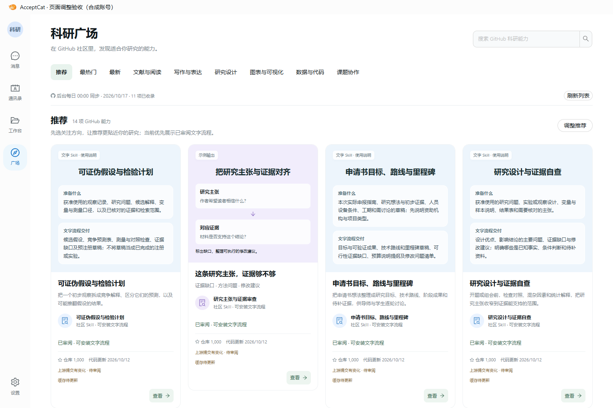
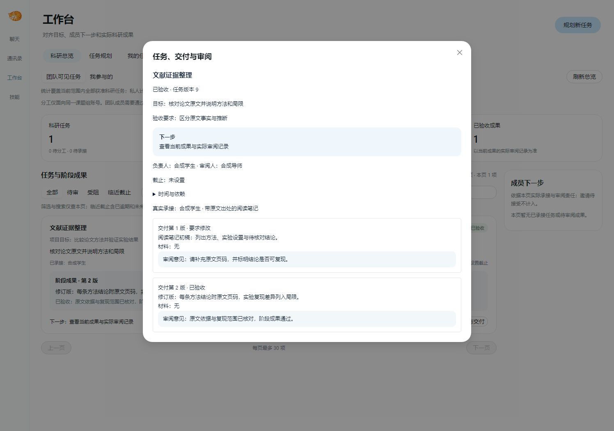

<p align="center">
  
</p>

<h1 align="center">AcceptCat</h1>

<p align="center"><strong>和学生、AI 一起，把科研任务推进到成果。</strong></p>

<p align="center">面向学校教师、科研工作者与实验室团队的科研协作桌面应用。</p>

<p align="center">
  Windows 优先 · 个人科研助理 · 课题组协作 · 可复用科研方法
</p>

<p align="center">
  <a href="#试用与下载">试用与下载</a> ·
  <a href="#从一次组会任务开始">看一次完整工作流</a> ·
  <a href="#找到适合当前研究的能力">探索科研能力</a> ·
  <a href="#开发与参与">开发与参与</a>
</p>

<p align="center">
  
  <br />
  <sub>桌面开发预览 · 实际组件、合成账号与示例目录事实；收录数量及版本范围以试用说明为准。</sub>
</p>

## 科研里的事情，应该接得上

一篇论文从聊天里发过来，一项任务在组会上布置，学生把新一版结果放进文件夹。到了下一次讨论，大家还要重新找：**目标是什么、谁接下了、卡在哪里、这次交付改了什么。**

AcceptCat 把这些事情放在同一个工作空间里：用聊天说清需求，用 AI 整理材料和研究思路，再把计划、分工、成果与审阅接起来。老师能看到需要自己决策的事情，学生知道下一步该做什么，个人也可以独立使用。

| 你现在要做的事 | 在 AcceptCat 里怎样开展 |
| --- | --- |
| 读一篇论文，准备组会讨论 | 交给文献助手，围绕问题、方法、结果和局限提问，并查看实际读取范围 |
| 把一个研究想法变成计划 | 整理目标、步骤、负责人、依赖关系和验收要求，确认后建立任务 |
| 和学生推进一项课题 | 邀请承接、记录阻碍、提交阶段成果，再由导师反馈、要求修改或验收 |
| 把好用的方法留下来 | 安装自己的 Skill，按次选择参考和获准材料，继续用于自己的 Agent |

## 从一次组会任务开始

> “这周先把这几篇论文的方法和实验设置比较清楚。小林整理证据，小陈检查实验条件，周五给我一版能讨论的材料。”

1. **先说清楚要交付什么。** 在个人助理中讨论目标，提供本次允许使用的资料。
2. **把计划变成可以承接的工作。** 调整步骤、负责人、前后依赖、截止时间和验收条件，再确认创建。
3. **进展和问题留在任务里。** 学生接受任务；缺数据、缺设备或需要导师决定时，记录阻碍及所需支持。
4. **交付的是具体成果。** 提交材料和说明，保留版本；导师可以要求修改，也可以明确验收。
5. **下次讨论接着往前走。** 在工作台查看当前进展、最新成果和下一步，不必重新拼凑每个人的聊天记录。

<p align="center">
  
  <br />
  <sub>协作流程预览 · 图中为虚构导师、学生和示例阅读任务；展示交付版本与反馈如何保留。</sub>
</p>

## 一个工作空间，几种日常用法

### 聊天：随时讨论，随时补充

人与 Agent 使用统一的联系人和聊天入口。支持流式回复、连续补充、附件阅读，以及图片粘贴、批量识字与正文整理。模型或网络出错时保留明确的状态和重试入口。你可以为自己的 Agent 选择模型，按需要维护可修改、可撤回的长期偏好。

### 工作台：把目标、分工和成果放在一起

科研计划可以先保存为草案，再确认成任务。任务记录承接、阻碍、阶段交付、反馈和验收；负责人查看获准范围内的团队进展。工作台聚焦课题组任务、我的任务和资料与素材库；研究计划与定时安排在“我的任务”，本机报告在“资料与素材库”。个人信息、设置、课题组能力和我的 Agent 统一放在侧栏“我的”，包括内置助手添加与技能/资料配置。支持一次、每天或每周的提醒与文字 Agent 定时任务，运行记录可查；关闭客户端后仍需后台服务持续运行。

### 资料与方法：按这次任务的需要使用

资料集合保留来源和版本，Agent 使用当前授权的材料；本机 Zotero 可选入个人库的元数据与摘要。你可以从文件夹、ZIP 或固定 GitHub 来源预览 Skill，再安装到自己的私人空间，选择本次要用的参考。**公开一个 Agent，不等于公开它背后的私人材料。**

## 找到适合当前研究的能力

广场只展示 GitHub 社区来源，支持推荐、Star 热门、代码最新，以及文献、写作、研究设计、图表、数据与课题协作等方向。先看它能交付什么、你需要准备什么，再决定是否使用。

当前可探索的方向包括：

- **文献与写作**：文献阅读、稿件修改、引用与证据自查。
- **研究设计**：选题价值、项目风险、竞争解释、可证伪假设与检验计划。
- **课题协作**：任务拆解、阶段材料、组会进展与下一步对齐。

社区条目保留作者、原仓库、固定审阅版本、许可、依赖和费用说明。后台每天北京时间零点同步 GitHub Star、代码更新时间和待审阅候选；**发现新仓库后仍要审阅，可使用的文字 Skill 与待接入工具会分别标明。**

> 截至 **2026-10-19**，据[目录运营记录](https://github.com/luoyan96/personal-agent/pull/66)，在线目录已收录 **11 项来源、涉及 7 个仓库**。联网检索、自动绘图、通用脚本执行和完整 PaperQA 等工具仍在适配；当前文字流程不等于这些工具已经接通。科研结论、引用和实验设计仍需结合原文与实际数据核对。

## 试用与下载

**AcceptCat 正在与小范围科研团队持续打磨，当前优先 Windows 桌面端。** 上面的预览来自较新的开发与试用版本。

| 版本入口 | 当前状态 |
| --- | --- |
| **最新桌面试用版：0.10.17** | 已制作并交付小范围试用，尚未上传公开 Release；按方向、分工和成果进度整理课题组任务，计划与定时安排收进我的任务。[查看试用与版本说明](docs/product-status.md) |
| **GitHub 公开下载：v0.6.0** | 可从 [Releases](https://github.com/luoyan96/personal-agent/releases/latest) 下载；安装文件仍叫 `ResearchWeChat_0.6.0.exe`，属于早期版本，未包含这里展示的全部体验 |
| **最新产品源码** | 当前集成在 [release/acceptcat-0.10.17](https://github.com/luoyan96/personal-agent/tree/release/acceptcat-0.10.17)；默认分支的应用代码仍是较早基线，文档与软件发布分别维护 |

已有试用版的团队：登录后在“我的 → 模型设置”配置自己的模型，从一个真实课题的小任务开始。新团队如希望参与试用，可以在 [Issues](https://github.com/luoyan96/personal-agent/issues) 留下使用场景和试用意向；请不要提交账号密钥、未公开论文或学生的私人材料。

应用侧栏“广场”下面提供“我的 → 版本与帮助”，左上头像也直接进入“我的”。它检查正式发布源；本地制作的新包或单纯推送代码不会自动变成可下载更新。社区目录更新由后台提供，通常无需重装客户端。

## 接下来，把科研里的重要需求做好

近期重点是让老师与学生真正用顺：**文献与资料处理 → 研究计划 → 分工推进 → 成果反馈 → 方法复用**。继续补齐受控检索、科研工具执行与中文科研结果验证，积累可检查的课题案例。

微信 / 企微连接器、面向广泛消费者的扩展和手机端暂缓。当前实现、验证边界和接续工作见[版本与试用说明](docs/product-status.md)。

## 开发与参与

欢迎带着具体科研任务来讨论：任务是什么、现在怎样做、哪一步最耗时、希望得到什么交付物。功能建议、问题反馈和可公开的最小复现都可以放到 [Issues](https://github.com/luoyan96/personal-agent/issues)。

<details>
<summary><strong>开发环境与仓库结构</strong></summary>

根工程要求 Node.js ≥ 22.19.0（建议 24）与 pnpm 11.21.0；Windows 桌面客户端在 `clients/openim`，独立使用 pnpm 10.28.0 和自己的锁文件。

```sh
git clone https://github.com/luoyan96/personal-agent.git
cd personal-agent

# 最新试用功能暂在此集成分支，main 仍保留较早应用基线。
git switch release/acceptcat-0.10.17
pnpm install --frozen-lockfile
pnpm run ci
```

以上是基础构建与检查，不会启动完整桌面服务或证明真实模型已连接。桌面构建、服务配置与部署按[贡献指南](CONTRIBUTING.md)、[客户端说明](clients/openim/RESEARCH-CLIENT.md)及对应版本交接进行。

| 路径 | 内容 |
| --- | --- |
| `clients/openim` | React / Electron 桌面客户端与即时通信集成 |
| `apps/api` | 科研任务、身份权限、聊天、资料与后台调度 |
| `packages/contracts` | 前后端共享契约 |
| `packages/research-core` · `packages/research-skills` | 科研对象与 Skill 加载基础 |
| `agents/skills` | 内置科研方法的单一内容源 |
| `integrations/deepseek-harness` | 受限运行适配 |
| `docs` · `evaluations` | 产品、开发、来源与验证记录 |

代码检查、真实模型效果与线上部署分别记录。私人研究材料、运行数据库和凭证不进入 Git。开发和试用的准确快照见[版本说明](docs/product-status.md)。

</details>

## 来源与致谢

AcceptCat 沿用作者既有科研项目探索；即时通信建立在 OpenIM 集成之上，桌面交互参考并改编 OpenMuse 的部分主题与布局，社区方法保留各自来源。感谢这些项目的维护者。

- [OpenIM](https://github.com/openimsdk) · [OpenMuse](https://github.com/CopilotKit/openmuse) · [DeepSeek Harness](https://github.com/deepseek-ai/deepseek-harness)
- 项目与各依赖的适用许可、改编范围见 [NOTICE](NOTICE.md)，图标和预览来源见[展示素材说明](docs/assets/README.md)。
- 工程演进保留在[项目日志](docs/project-log.md)与[历史 README](docs/history/readme-before-product-intro-20261016.md)，首页专注介绍产品与试用方式。
