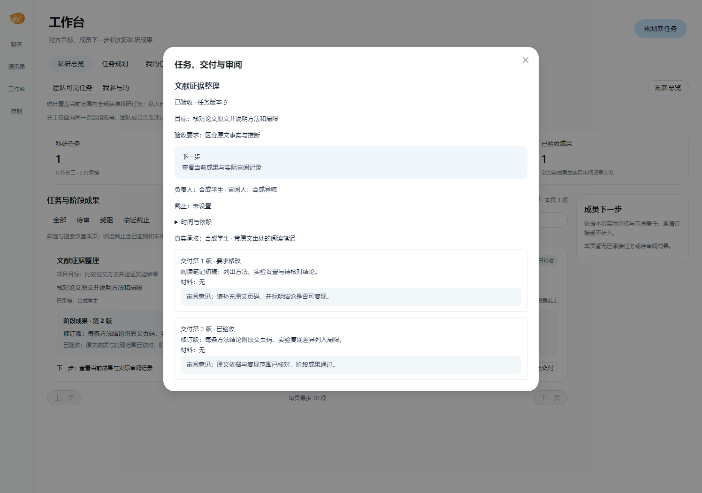

<p align="center">
  
</p>

<h1 align="center">DeepChat</h1>

<p align="center"><strong>给课题组用的科研协作软件</strong></p>
<p align="center">老师在群里交代的事，学生点开就能接着做。交上来的文件、老师的意见和下一版修改，都留在同一项任务里。</p>

<p align="center">
  <a href="https://github.com/luoyan96/personal-agent/releases/download/v1.0.0/DeepChat_1.0.0.exe">下载 Windows 版 · 1.0.0</a>
  · <a href="#第一次使用">第一次使用</a>
  · <a href="https://github.com/luoyan96/personal-agent/releases/tag/v1.0.0">发布说明</a>
</p>

## 下周组会，汇报一下项目进展

周一，老师在课题组群里给小林留了条消息：

> 小林，下周组会你讲一下项目进展，十分钟就好。上次换了实验条件，结果怎么样？还有哪一步卡住了，需要大家帮你拿个主意？周五先发我一版。

**小林点开邀请，就知道这周要交什么。** 老师把这条讨论安排成任务，小林从群里的邀请直接进入。周五交初稿、汇报只有十分钟、要比较哪两轮实验，都能回到原来的讨论核对。

**准备汇报时，助理接得上前面的话。** 小林从任务打开 DeepChat 工作台，问：“十分钟怎么安排？我最想讲清楚换条件前后的差别。”助理能接着这项任务的讨论，参考任务里选好的实验记录和组会模板。模板放在课题组的 GitHub 仓库里，组里换了新版，同步后就能选用。小林之前纠正过助理：“帮我列汇报提纲时，先讲结论，再讲过程。”这次允许使用的这条习惯也会跟过来。

**周五，老师能对着具体的文件给意见。** 小林把《项目进展汇报.pptx》拖进任务，确认提交。老师看完初稿，留下反馈：“第 4 页把两轮实验放到同一张图里，标清各自的样本量。最后一页把要大家决定的问题写出来。”

**到了组会，直接看修订版。** 小林按意见改好，把第二版交回同一任务。老师可以对照初稿和反馈验收。会上再问“这张图为什么这样改”，两版文件和当时的理由都找得到。

<p align="center">
  
  <br />
  <sub>另一项示例任务的审阅页面。老师和学生可以沿着版本看到每次改了什么。</sub>
</p>

## 第一次使用

下载 Windows x64 客户端，登录后在「我的 → 模型设置」配置自己的模型。第一次试用，可以拿一份可分享的组会材料走一遍：一人在群里发任务邀请，另一人接下任务、交一份文件，再把修改意见回到这份交付上。

工作台随客户端安装，在本机处理文件；编辑 Office 文件需要本机安装 WPS 或 Microsoft Office。当前以 Windows 小范围试用为主。已有账号可在「我的 → 版本与帮助」检查更新。[当前版本](docs/current-state.md) · [下载历史版本](https://github.com/luoyan96/personal-agent/releases)

## 开发与参与

欢迎带着具体科研任务来讨论：任务是什么、现在怎样做、哪一步最耗时、希望得到什么交付物。功能建议、问题反馈和可公开的最小复现都可以放到 [Issues](https://github.com/luoyan96/personal-agent/issues)。

<details>
<summary><strong>开发环境与仓库结构</strong></summary>

根工程要求 Node.js ≥ 22.19.0（建议 24）与 pnpm 11.21.0；Windows 桌面客户端在 `clients/openim`，独立使用 pnpm 10.28.0 和自己的锁文件。

```sh
git clone https://github.com/luoyan96/personal-agent.git
cd personal-agent

# main 为当前共同开发基线；每项功能从最新 main 单独开分支。
git switch main
git pull --ff-only
git switch -c feat/your-feature
pnpm install --frozen-lockfile
pnpm run ci
```

以上是基础构建与检查，不会启动完整桌面服务或证明真实模型已连接。桌面构建、服务配置与部署按[贡献指南](CONTRIBUTING.md)、[客户端说明](clients/openim/RESEARCH-CLIENT.md)及对应版本交接进行。

| 路径 | 内容 |
| --- | --- |
| `clients/openim` | React / Electron 桌面客户端与即时通信集成 |
| `apps/api` | 科研任务、身份权限、聊天、资料与后台调度 |
| `packages/contracts` | 前后端共享契约 |
| `packages/research-core` · `packages/research-skills` | 科研对象与 Skill 加载基础 |
| `agents/skills` | 内置科研方法的单一内容源 |
| `integrations/deepseek-harness` | 受限运行适配 |
| `docs` · `evaluations` | 产品、开发、来源与验证记录 |

代码检查、真实模型效果与线上部署分别记录。私人研究材料、运行数据库和凭证不进入 Git。开发和试用的准确快照见[版本说明](docs/product-status.md)。

</details>

## 来源与致谢

DeepChat（原 AcceptCat）沿用作者既有科研项目探索；即时通信建立在 OpenIM 集成之上，桌面交互参考并改编 OpenMuse 的部分主题与布局，社区方法保留各自来源。感谢这些项目的维护者。

- [OpenIM](https://github.com/openimsdk) · [OpenMuse](https://github.com/CopilotKit/openmuse) · [DeepSeek Harness](https://github.com/deepseek-ai/deepseek-harness)
- 项目与各依赖的适用许可、改编范围见 [NOTICE](NOTICE.md)，图标和预览来源见[展示素材说明](docs/assets/README.md)。
- 工程演进保留在[项目日志](docs/project-log.md)与[历史 README](docs/history/readme-before-product-intro-20261016.md)，首页专注介绍产品与试用方式。
