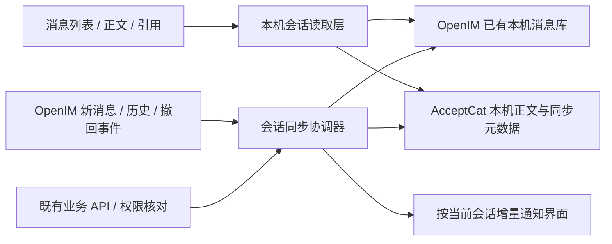

# 本地优先聊天历史：问题、方案与 AI 实施交接

日期：2026-10-30。状态：**实施说明，尚未完成改造**。交给其他 AI 时可直接使用最后一节的 prompt。

## 1. 要达到什么效果

用户希望像熟悉的桌面即时通讯软件一样：看过的聊天能保存在本机，打开会话、切换聊天、往上翻和重启后阅读，不必反复等待后台返回正文；断网时已保存内容仍可阅读。

这里借鉴的是使用体验，本文没有验证或复刻微信内部实现。**本地优先读取与服务端转发可以同时存在**：

| 内容 | 应放在哪里、由谁负责 |
| --- | --- |
| 已下载的消息正文、引用、附件元数据、显示身份、历史位置 | 本机持久化，聊天界面优先读取 |
| 新消息发送、离线投递、跨设备同步 | 继续使用 OpenIM 与既有后台 |
| 账号、群成员、资料和任务权限 | 继续由后台判定，历史缓存不能授权操作 |
| Agent 的模型调用、活跃运行状态 | 继续既有执行链；本次不将其迁移到本机模型 |
| 附件原件 | 下载成功后才属于本机可离线打开的文件，不能只保存链接就声称已缓存 |

目标是减少重复拉取、等待和逐条轮询，不承诺后台零负担，也不取消服务端共享记录。首批优先 Windows，兼容现有 Web 联网路径；不扩展手机、知识库或 DSH 工作台重构。

## 2. 从哪个版本继续

2026-10-30 核对快照，开始实施前必须重新获取实际状态：

- 主仓库：[luoyan96/personal-agent](https://github.com/luoyan96/personal-agent)，main 为 `b1fda98d113ca2feacfe74ab50a56efe8a2c7658`。
- 最新稳定包：[Windows 0.10.75](https://github.com/luoyan96/personal-agent/releases/tag/v0.10.75)，发布标签为 `bb40f76ec9cf0b41b9c2cf0fab8fe41799a04f73`。main 后续差异是发布文档，未增加产品运行代码。
- 最终安装器为 405061949 字节，SHA256 `aac075610ffc89a876dac3db5eebe06de679d6bd5ee6f468ee2d434373004755`。本机同号早期候选包摘要不同，不能混用。
- 后台 contract `0.39.0`，部署记录 schema `031`。公网 ready 的数据库/存储/认证为 ok，harness 为 not_verified，不代表真实模型已验收。
- 未完成分支 `fix/chat-local-history-and-group` 的 `5536ffc` **未合入主线或安装包**。可以阅读其实现，不能回到旧基底覆盖当前版本。

保留 0.10.75 新增的任务页折叠区、下一步主操作、任务与工作台往返、工作文件夹/DSH 会话展示和目录命名；保留之前恢复的原生文件/PDF预览、模型及推理菜单。此次只改聊天历史所需代码。

开发前先读根 `AGENTS.md`、[CONTRIBUTING](../../CONTRIBUTING.md)、[当前状态](../current-state.md)、[项目日志](../project-log.md)最新记录和[项目总览](../project-overview.md)。使用自己的 clone/worktree 与最新主线功能分支，别人的目录和正在运行的客户端保持原状。

本机参考副本为 `D:/deepseek-agent/acceptcat-chat-experience`，此交接文档在独立工作树 `D:/deepseek-agent/acceptcat-chat-history-docs`。实施 AI 先核对归属，不在别人的工作目录切分支或清理构建产物；如多人并行，另建自己的工作副本。

## 3. 已确认的问题与代码位置

以下路径均相对仓库根目录；函数名优先于可能变化的行号。

| 问题 | 当前代码与依据 | 需要改变的行为 |
| --- | --- | --- |
| 本机有通信数据目录，但不是完整业务正文缓存 | `clients/openim/src/layout/useGlobalEvents.tsx` 的 `tryLogin` 给 SDK 设置 dataDir；`electron/main/appManage.ts` 指向 userData/OpenIMData/sdkResources | 先利用 SDK 的已有存储能力，不编辑 SDK 私有数据库或制造第二套通信协议 |
| 科研消息只带定位信息 | `packages/contracts/src/openim.ts` 的 `OpenImResearchPointer` 仅含会话、消息 ID、sequence；`src/research/chat-message-read.ts` 的 `readChatMessage` 再调用业务 API | 下载过的真实正文与定位映射都要持久化，而非只存消息壳 |
| 打开历史仍逐条加载正文 | `src/research/ResearchMessageRender.tsx` 使用 `useResearchRead`，无正文就显示“正在加载消息” | 渲染先取本机正文，缺少的再合并读取 |
| 每条旧消息持续轮询 | `src/research/useResearchRead.ts` 每个挂载实例约5秒读取；正文、turn、群 Agent 状态分别使用它 | 静态正文与活跃状态分开，按会话协调、共享请求和去重；不能只改成每条60秒 |
| 弱网会把已显示内容清掉 | `useResearchRead` 在失败和范围变化时清 result | 普通超时/断网保留同账号同会话已有正文，显示同步状态；明确失去权限单独处理 |
| 历史显示被连接与同步门槛挡住 | `src/pages/chat/queryChat/useHistoryMessageList.tsx` 的 sdkReady 要求登录、连接、同步成功；会话/就绪变化时清列表再读 | 本机读取与通信就绪解耦，重连不先清空屏幕 |
| 冷启动仍要求业务后台在线 | `useGlobalEvents.tryLogin` 先读 session/imSession；失败路径可能 logout、清 IM 档案并返回登录页 | 为既有、已核验的本机账号设计离线只读恢复；网络错误与明确登录失效不能混同 |

范围覆盖主消息区中的真人私聊、个人助手私聊、群聊和群内多个 Agent 的已完成回答。DSH 自己的会话历史不迁入本库；任务规划助手与资料助手的独立会话入口也不借机重写，但不能被此次改动破坏。

## 4. 旧分支能复用什么，为什么不能直接合

`5536ffc` 新增了以下设计：

- `electron/utils/chatHistory.ts`：SQLite 消息、正文事实、分页连续性与服务/账号隔离。
- `electron/main/chatHistoryManage.ts`、preload、类型：基于当前桌面身份的 IPC 租约。
- `src/research/local-chat-history.ts`、`useLocalChatRead.ts`：本机读取、存储状态、后台核对和失效通知。
- 历史 hook、全局消息事件、撤回/删除与业务正文渲染接入。

旧分支的4项 SQLite 单测重跑通过，但新增顺序反例复现了下面3个问题。下列步骤可独立重建，不依赖私人资料：

| 反例 | 操作与实际结果 | 必须补修 |
| --- | --- | --- |
| 实时消息跨过断档 | 存入1至10并标记到开头；下一条实时消息21到达；旧 hook 用 `[最后可见10, 新消息21]` 保存，数据库直接连成21→10，并误称历史完整，11至20消失 | 实时事件不能凭相邻显示位置建立已同步连续性；缺口只可由可信分页/同步结果关闭 |
| 撤回被旧页覆盖 | 保存普通消息→收到撤回并落盘→此前发起的历史页晚到→关闭重开，数据库又变普通文字 `contentType=101` | 落盘合并也要遵守版本/撤回优先，不能只保护 UI 内存 |
| 本机删除后重新写入 | 保存1至3→本机删除2→旧历史页1至3晚到→重开，2又在数据库 | 持久删除标记必须拦截旧 upsert；前端最多若干条的 hidden 列表不能充当永久删除事实 |

另外，旧 IPC 的 open 仍请求远端 auth/session，冷启动断网仍卡住；完成正文仍按每条60秒刷新。旧实现只能作为参考，不是已经完成的本地优先方案。

旧 WIP 可能仅存在本机分支引用。其他机器若取不到该提交，不需要等待它公开或擅自推送旧代码；依据本文需求、当前主线及上述可复现顺序实施即可。

本机排查证据在 `D:/deepseek-agent/.runtime/chat-local-history-audit-20261030/`：`audit.mjs`、`archived-four-tests.log`、`audit-results.json`。这些是隔离 SQLite 与合成事件顺序检查，不是真实 SDK、离线界面或安装验收。其他机器不必拥有该目录，按本节重建用例即可。

## 5. 推荐方案：本地阅读层＋会话同步层



### 5.1 数据落盘与单一所有权

保留 SDK 对通信记录的所有权，使用公开 SDK 接口读取；**不改 SDK 内部表**。AcceptCat 新库主要补业务正文、定位映射、已核对状态和本机读取索引。确需镜像 SDK 消息页以支持冷启动时，应说明必要性，并沿同一写入入口同步，避免两个互相矛盾的消息库。

建议在 `app.getPath('userData')` 下建账号隔离的聊天数据目录，不硬编码用户名或 D 盘路径。可采用旧分支 SQLite 思路；当前 Electron43.8.4 的实际运行时须验证 `node:sqlite` 可用，不能仅凭终端 Node 的测试通过就认定安装包可用。无需为本批引入另一套重型服务。

建议保存的信息，而非要求固定表名：

| 信息 | 必须保留的边界 |
| --- | --- |
| 本机账号与会话目录 | 服务身份＋业务 memberId 隔离；只保留可用于恢复界面的必要会话/身份投影 |
| 消息正文与引用 | businessConversationId/messageId/sequence，与 IM conversationID/clientMsgID 明确映射 |
| 同步范围与游标 | 区分最旧已知、最新已知、缺口和服务端分页回执；仅成功落盘后推进 |
| 撤回标记 | 服务端确认的撤回、版本/来源，阻止旧页恢复正文；同步更新引用预览和可复制文字 |
| 本机删除标记 | 账号＋会话＋消息作用域，与全员撤回分开；关闭、重启和迟到请求均不能恢复显示 |
| 附件元数据与本机路径 | 文件身份、下载完成状态、实际可用路径；缓存链接不等于本机已有原件 |
| 终态显示信息 | 可缓存历史显示投影，不能把 allowedActions、私有 turn 或旧 ACL 当成当前操作权限 |

数据结构要有 schema 版本及可重复迁移；同一账号并发写入统一排队，正文、标记与游标原子提交。限制单页/单事务以免卡住 Electron 主进程，不把所有历史一次读入 React。磁盘写入失败要明确退化为联网模式，不伪称“已经保存”；不能通过自动删除全部历史掩盖损坏。认证 Cookie 和模型密钥不写进正文库。

### 5.2 打开会话的顺序

1. 取得当前已核验的本机账号上下文，读取本机已知会话和当前页；此步骤不等待后台、WebSocket 或全量 SDK 同步成功。
2. 有已存正文就显示，恢复阅读位置；本机缺少的内容明确显示未保存，不能拿空白当作没有历史。
3. 在后台核对会话与权限，连接 SDK，按需补齐新消息或缺失正文。一个会话共享同一同步任务，多个组件订阅结果，不各自启动相同读取。
4. 结果先幂等落盘，再按稳定消息身份合并到当前界面。切换会话/账号后，晚到结果可以进入其正确账号会话的存储，但不能进入当前另一会话；若身份租约已失效则不得写入新账号。
5. 联网失败保留当前已读内容，给出轻量“离线/同步未完成”状态；恢复连接后继续原游标，不先清空消息列表。

不要用“开屏 spinner 变短”代替本地读取。需注入30秒服务延迟验证：本机已保存的正文在服务响应之前就能阅读。

### 5.3 历史补缺、顺序与去重

- IM seq 和业务 sequence 是不同序列；排序、定位、映射各自明确，不混用。
- 服务端授权过滤可能造成业务序号不连续，不能看到数字跳号就断定丢消息。以接口分页回执、SDK 已核对范围和已知映射判断缺口。
- 实时收到“21”不能证明“10至21”连续；不能使用最后一条可见消息与新事件直接拼接历史边。
- 同一消息可能由发送回执、实时事件、后台正文和历史页重复到达，统一按稳定键合并；重复事件不得增加消息条数或重复模型调用。
- 保存不同时间段后，仍要能继续请求中间未知范围。拿不到缺口不能显示“没有更早消息”。
- 翻旧消息优先本机分页，缺口或未下载范围才联网；不要求用户首次打开就全量下载全部会话。

### 5.4 正文、动态状态与操作分开

已完成正文按需缓存，不为每条历史消息永久创建5秒或60秒定时器。尽量用会话分页批量取得缺少的正文；详情、引用和可变状态按需要核对并去重，不能为省请求丢掉引用关系或附件信息。

仅活跃 Agent 工作维持必要的状态更新；终态后停止高频查询。`waiting_input` 是等待用户补充，不得误标为任务完成。群内其他成员只读获准的群状态接口，不能因缓存层而调用原请求者的私有 turn/progress。

打开旧记录不重启 Agent、不重新发送问题、不制造“正在恢复回复”。发送、重试、撤回、转发、调用工具仍走当前权限和既有幂等链；不得创建一个隐式重放全部离线消息的队列。

### 5.5 撤回与删除必须贯穿存储和渲染

服务端确认的撤回是单调状态：晚到的历史页、发送回执或缓存刷新不能覆盖回普通正文。本机删除是本账号的显示/存储策略，不等于为其他成员撤回；删除标记要在 upsert 和查询两处生效。

撤回后要同步处理气泡、引用预览、复制、搜索结果和本机全文索引（如有），不能正文隐藏但另一处仍显示旧文。附件原件已在本地的处理沿既有规则，不声称能追回别人已经保存的副本。批量操作保留逐项结果，失败后重试不能重复处理已确认项目。

## 6. 后台到底要不要改

**第一批可以复用现有接口，主要改客户端，不把后台升级设为本地阅读的前置条件。** 这不代表现有接口已经具备完整的变更流。

| 现有能力 | 用途与限制 |
| --- | --- |
| `chatMessages`：按 sequence、cursor 分页 | 批量取得有权读取的正文、补齐新消息；cursor 与 afterSequence 不能同时传 |
| `chatMessageDetails` | 核对某条消息的撤回、版本、引用关系和当前动作；避免每条挂载后永久轮询 |
| `withdrawChatMessage` | 已有撤回写入与幂等/版本检查，不另造客户端假撤回 |
| `chatMessageAgentStatuses`、`chatTurn`/progress | 群状态与本人运行状态分开读取，活跃期间继续真实更新 |
| OpenIM 公开历史与撤回接口/事件 | 同步通信层记录；须实测重连和离线补发覆盖范围，不凭 API 名称推断一定收到全部事件 |
| session、会话及成员接口 | 账号和权限核对，网络故障与明确撤权区别处理 |

关键限制：**afterSequence 只解决新增消息，旧消息被撤回不会自动变成一个更大的业务消息序号。** 目前 `retractMessage` 写入独立撤回表；重新读详情或投影能反映，但只读“最新序号之后”会漏掉旧消息变化。

首批兼容方案：利用已验证的 SDK 事件更新即时状态；打开/重连时对可见及需恢复的历史范围重新核对，按会话协调，限制并发、避免逐条常驻轮询。需要记录“哪些范围已核对”，未核对的离线旧范围不能声称是最新状态。操作前仍重新授权。

如果实施验证表明，现有事件与有界核对无法满足目标范围的正确性或请求量，再提出**最小、兼容旧客户端的批量详情或变更同步接口**。要说明具体缺口、旧接口降级方式和验证结果，不能默默扩成重写 IM 后台。若增加变更游标：撤回/权限事件需与原写入可靠关联、分页有界、逐条授权、游标可失效并重新对账，不能泄露其他用户消息。共享契约、数据库迁移和部署要求需单独记录，部署仍需负责人授权。

不能用轮询所有消息、启动时全库重新下载或放宽权限来宣称“无需后台改动”。若这一限制会使某项验收无法通过，明确报告，不能假装已解决。

## 7. 断网、账号与权限的规则

这里是目标约束，不表示旧分支已经实现：

- 只为本机曾完成在线验证、尚未明确退出的账号恢复已下载历史。身份应来自受控本机记录，不能让渲染层随意传入 memberId 打开任意账号库。
- Cookie/CSRF 会话机制继续沿用，不能假设后台支持 Bearer Token。IPC 仍验证受控页面/框架、服务、账号和租约；不要在渲染层暴露数据库路径与任意 SQL。
- 普通断网/超时不自动清除本机历史或当作明确登出。明确401/登出时关闭当前读取入口并使旧请求失效；是否保留磁盘文件与是否允许当前读取是不同问题。
- 换账号、换服务后不显示前一账号的消息、草稿、引用或私有运行信息。新授权不能复用旧租约，日志不得打印正文/认证材料。
- 已确认的离组或撤权按既有规则隐藏/失效受保护缓存，不能以“本地有”绕过。不能把任意单条附件404、网络500或接口能力缺失都当成全会话撤权而删除全部历史。
- 离线无法获知尚未同步的远端撤权/撤回，界面应说明当前为本机历史及上次核对状态，不能承诺即时撤权。恢复联网先核对权限，再恢复发送和其他业务操作。
- 离线时只读已下载内容，不能承诺发送成功、实时群成员有效、调用模型可用或打开未下载附件。

离线历史的保留政策要与当前产品权限规则一致。如需要改变“离组后是否保留过去已下载文字”等规则，单独列出决策，不能由缓存实现暗中改变。不得用“为了离线”作为去掉鉴权的理由，也不得为了每次鉴权而重新阻塞所有已存消息阅读。

## 8. 建议修改位置与集成边界

| 层次 | 主要入口 | 本批注意点 |
| --- | --- | --- |
| Electron 持久化 | `clients/openim/electron/main`、`electron/utils`、`electron/preload/index.ts`、`src/types` | 数据库、迁移、受控IPC、账号生命周期；不动用户真实聊天库验证 |
| 会话读取与同步 | `src/pages/chat/queryChat/useHistoryMessageList.tsx`、新增会话存储/同步模块 | 本机先读、按会话去重、缺口、重连；不依赖连接成功才能显示 |
| 正文与状态 | `src/research/ResearchMessageRender.tsx`、`chat-message-read.ts`、`GroupMessageStatuses.tsx` | 业务正文持久化，动态状态单独协调；私有回合接口不扩大可读范围 |
| 登录与全局事件 | `src/layout/useGlobalEvents.tsx`、`src/research/store.ts`、`src/research/api.ts` | 区分断网和失效；非当前会话事件也可靠落盘，迟到结果有账号/服务屏障 |
| 删除与阅读体验 | `src/research/ChatMessageActions.tsx`、`chat-timeline.ts`、`ChatContent.tsx` | 持久标记、引用/搜索一致、分页与滚动位置稳定 |
| 后台（仅必要时） | `packages/contracts`、`apps/api/src/chat.ts`、`chat-message-actions.ts` | 最小兼容接口，保留既有ACL、旧读取和历史；不默认需要部署 |

不要直接给全局 `useResearchRead` 加一个“失败不清空所有数据”的开关来解决所有页面。任务、资料等现有界面需要其权限失效语义；聊天应通过自己的会话读取层承接，或在确有必要时做窄范围重构并验证其他调用方。

## 9. 一个交付批次，三个内部检查点

不新增很长路线图。按以下顺序完成同一批改造，每步都保留可验证结果：

1. 本机存储与确定性合并：账号隔离、迁移、正文/映射、删除/撤回标记和缺口；先让已知3个顺序反例不再发生。
2. 接通读取与同步：本机先显示、按会话核对、活跃状态、重连和离线只读；保留当前聊天、任务、工作台行为。
3. 隔离桌面验收与交付：真实 Electron/SDK 加合成账号/服务验证，再做适用类型/构建和包内检查；PR交付，安装包、公开发布、后台部署分别安排。

## 10. 验收清单

以下测试需要能证明行为，不能只对源码做字符串断言：

| 场景 | 应验证的结果 |
| --- | --- |
| 看过的私聊、Agent 回复、群聊反复切换 | 本机已存正文先显示，后台延迟不遮住阅读；不重复气泡 |
| 关闭重启，后台响应延迟30秒 | 已核验账号的已存历史可先读；离线入口不被登录循环挡住 |
| 断网后向上翻 | 已存页可读；未知范围明确未保存，不能误称到达历史开头 |
| 保存1至10，跨离线收到21 | 不把11至20默默跳过或误标完整；授权过滤造成的合法序号间隔不死循环 |
| 实时、历史和发送回执乱序/重复 | 稳定去重、游标不提前推进、正文不倒退 |
| 撤回后旧历史页晚到，再重启 | 气泡、引用、复制和索引不恢复被撤回正文 |
| 本机删除后旧页晚到，再重启 | 本机删除仍生效，不为其他成员伪造撤回 |
| 权限变化、401、换账号和换服务 | 无串号，无旧操作权限；网络故障不误清记录，明确撤权不继续暴露受保护内容 |
| 离线期间另一端撤回旧消息 | 重连/打开相关历史范围能重新核对；不能仅看新增消息游标 |
| 两个 Agent 同时回答、引用追问 | 回答归属和对应请求清楚；打开旧历史不重新调用模型 |
| 滚动读旧记录时收到新消息 | 当前位置稳定，返回最新与引用定位可用 |
| 附件有/无本机原件、路径失效 | 状态真实，未下载不声称可离线打开，不扩大原资料权限 |
| 已完成消息数量增加 | 记录请求计数：已挂载旧消息不各自永久轮询，同会话重复读取共享请求 |
| 写库失败/迁移重跑/进程中断 | 已确认的记录与游标一致，失败可报告与恢复，不破坏已有SDK数据 |
| 正式包与 Web 联网入口 | 包中包含所需IPC且实际运行时可用；无 Electron 时正确走兼容路径 |

根工程 pnpm11.21.0、客户端 pnpm10.28.0，按 CONTRIBUTING 冻结安装和构建共享依赖。客户端执行实际新增的存储/同步/身份定向测试，以及 `typecheck`、`typecheck:electron`、`build:web` 和受影响交互检查；共享契约/后台有改动时按 AGENTS 执行根 CI。成品验证使用隔离 userData，不操作用户当前客户端或真实私人资料。

交付报告分别写明：工程检查、成品包、隔离离线界面、真实账号/模型/双机验收哪些通过。纯模拟数据和SQLite单测不等于真机通过。更新 `docs/current-state.md` 并追加 `docs/project-log.md`，说明是否需要后台改动、接口兼容、产物来源和剩余限制。

## 11. 可直接交给实施 AI 的 prompt

```text
请实施 AcceptCat 本地优先聊天历史改造，先阅读：
AGENTS.md、CONTRIBUTING.md、docs/current-state.md、docs/project-log.md最新记录，
以及 docs/development/chat-local-history-implementation.md 全文。

从主仓库实际最新main创建独立功能分支/工作目录，保留已有修改。
本说明基线是Windows0.10.75/main b1fda98，开始前重新核验实际版本。
保留任务页与DSH工作台的新改动、原生文件/PDF预览和模型菜单。

目标：已下载的聊天正文、引用和必要元数据落盘；打开会话先读本机，
后台按会话补缺与核对，断网不清空已存内容，已完成历史不逐条永久轮询。
通信投递、账号权限、共享业务和模型调用继续使用现有后台。

参考但不要直接交付旧分支fix/chat-local-history-and-group/5536ffc。
必须修复文档中列出的断档误判、撤回被旧页覆盖和本机删除后恢复三个反例。
同时处理冷启动离线只读、账号/服务隔离、真实权限失效和迟到结果。
不能只改加载文案或只把轮询间隔调大。

先复用现有API；afterSequence只能同步新增，不能代替旧消息变更同步。
如现有事件/有界核对无法满足正确性和请求量，说明证据再提出最小兼容接口；
不要擅自部署后台或改写整个IM架构，不用历史缓存授予操作权限。

按文档验收，使用合成材料与隔离Electron/SDK，不操作我正在用的客户端。
完成必要检查并更新状态/日志，通过PR交付。
合并、安装包、公开发布和后台部署按我另行授权分别处理。
先简报实际基线与实施范围，然后开始实现，不停留在重复写方案。
```
