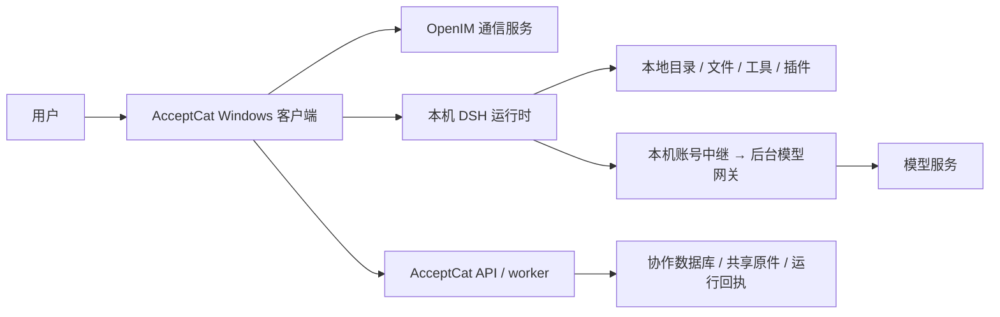

# AcceptCat 整体项目规划与实现总览

更新：2026-10-29。本文是产品、架构、规则和后续工作的统一阅读入口，面向负责人、同事及新接手的 AI。历史设计和测试记录继续保留；版本、部署和发布状态以最新[当前状态](current-state.md)、实际 Git/Release 和部署回执为准。

## 1. 我们要做什么

AcceptCat 先服务中国教师、科研人员和课题组，把日常交流、任务安排、实际执行和成果积累连接起来。先在自己的课题组持续使用，再根据真实问题完善，不以复制完整办公平台或知识库为近期目标。个人账号可以独立使用，不要求先加入课题组。

核心流程是：**讨论需求 → 确认任务与承接人 → 在本地工作台处理文件和工具 → 提交成果 → 人工审阅验收 → 按需共享和复用。** AI 可以提出建议、执行获准工作；正式分工、团队共识、共享范围和成果验收需要明确的业务记录或人工确认。

| 入口 | 当前职责 |
| --- | --- |
| 消息 | 人与人、人与 Agent 私聊和群聊，提及、引用及协作回执；体验以熟悉的即时通讯习惯为依据 |
| 通讯录 | 联系人和智能体分类展示；智能体保留归属和可用范围，不把技术通信账号当作真人 |
| 任务 | 计划、承接、转交、依赖、进度、提交与审阅，是团队协作事实的入口 |
| 工作台 | 内置 DSH 的本机执行环境；会话、文件、工具、插件、模型选择及原生预览 |
| 资料 | 轻量共享的原件、来源和版本；接收选定成果，按权限供任务取用 |
| 我的及设置 | 账号、个人偏好和相关配置；私人内容不因加入群聊而自动共享 |

旧工作台中的任务管理已经归入“任务”；原 DSH 页面改名“工作台”。两个入口各有职责，通过任务工作页和返回链接连接。

## 2. 已经做了什么，做到哪一步

以下是 2026-10-30 的核对快照，接手时必须重新核验，不能把本文版本号当成固定常量。

| 层次 | 已核对事实 |
| --- | --- |
| 主仓库源码 | [PR147](https://github.com/luoyan96/personal-agent/pull/147) 已整合 PR143、144、145、146，main 为 `bb40f76ec9cf0b41b9c2cf0fab8fe41799a04f73` |
| Windows 构建 | `0.10.75` 已公开为稳定版（2026-10-30），标签固定 `bb40f76`；见[0.10.75 发布回执](deployment/acceptcat-0.10.75.md) |
| 公开安装版本 | 稳定 Latest 为 [v0.10.75](https://github.com/luoyan96/personal-agent/releases/tag/v0.10.75)（2026-10-30） |
| 生产后台 | 2026-10-29 19:41 完成 API/worker 配对升级，contract `0.39.0`、schema `031`、镜像 `c12e3e42…`；部署记录与运维工具已随 PR143 合并 |
| 体验验收 | 类型、构建、定向检查及隔离交互已有回执；真实私人材料、付费模型、多账号和双机连续科研体验仍需使用者验收 |

主要能力已经形成首版：

- **账号与沟通基础**：现有账号、Cookie/CSRF 会话、OpenIM 通信、真人/Agent 身份和群权限继续复用；建群与邀请分类、业务群主、待接受成员已纳入最新主线。
- **任务协作**：需求讨论、计划确认、承接与转交、依赖关系、成果提交和审阅分别有业务状态；任务依赖图及标题可读性已有修正。
- **本机工作台**：随安装包携带固定 DSH 运行时，随账号生命周期管理；模型使用 AcceptCat 账号授权通道。原生模型与推理菜单、文件路径、目录选择及 PDF/文本/图片预览已恢复并做隔离验证。
- **三步集成首版**：任务中执行、规则/记忆/交接、群内安排文献任务和设备执行协调已经实现；这表示代码和合成闭环完成，不表示全部实际科研场景通过。
- **本地材料与共享**：从本地目录开始，按版本取用共享原件，选定成果归档；共享原件支持 512 MiB 分块与恢复。本地文件不沿用共享上传大小上限，原件保存与文字提取预算分别处理。

尚未完成或未整合的事项：本地聊天历史改动 `5536ffc` 仍在 `fix/chat-local-history-and-group` 分支，不在上述安装包；不能宣称历史消息已完全本地优先或可离线使用。手机试做 PR90 暂缓。Mimir、SciencePrism、AgentTeams 是研究参考，没有作为整套系统安装或替换工作台。自动 Agent 团队、全量知识库、全机索引及无人工确认的团队记忆均不是当前完成能力。

## 3. 项目框架怎样搭建

采用 TypeScript 多包仓库，保留正式桌面客户端、平台 API 和 DSH 适配边界。客户端负责交互；后台负责账号、权限与共享协作事实；本机 DSH 负责获准的本地工具和文件操作。

这是一套本机执行与服务端协作结合的架构。本机 DSH 不代表模型在本机推理，也不代表可以取消后台。模型密钥继续由既有服务管理；账号、群成员、任务、资料授权与共享版本仍需要后台。普通群内 Agent 问答继续既有服务端执行链，不能把它与任务工作页中的本地 DSH 执行混为一条链。

聊天消息经过通信服务传递，与客户端保存历史并不冲突。本地历史可以减少重复读取和改善打开速度，但不能代替跨设备同步、离线投递和身份权限服务；目前未整合的缓存工作不能被描述为现成功能。

| 目录 | 负责什么 |
| --- | --- |
| `clients/openim` | 正式 React/TypeScript + Electron 客户端及桌面适配；有独立锁文件 |
| `apps/api` | 权威业务 API、持久化、迁移、worker、权限和模型调用协调 |
| `packages/contracts` | 共享接口、结构与状态契约；前后端共同遵守 |
| `packages/research-core` | 与 Harness 无关的科研业务逻辑 |
| `packages/research-skills` | 方法、默认角色和共同规则的解析、校验及构建产物 |
| `agents/skills` | 科研方法内容的唯一来源 |
| `agents/roles` | 默认角色、人格、工作方法与共同同事风格的唯一来源 |
| `integrations/deepseek-harness` | 服务端和桌面 DSH 适配、固定运行时清单、本地会话及上下文装配 |
| `deploy`、`evaluations`、`docs` | 部署和检查工具、公开/合成评估、设计与交付证据 |

旧 `apps/web` 保留已有入口和验证用途，正式桌面工作以 `clients/openim` 为准。DSH 通过接口和受控桥接集成，不把上游源码整套复制进仓库；保留其好用的文件、预览、模型与插件能力。

构建基线：根 Node.js ≥22.19、pnpm 11.21.0；客户端 pnpm 10.28.0、Electron 43.8.4；Windows 内置 DSH 固定 `0.2.1-rc.3`。云端 Harness 是独立运行环境，不能用 Windows 包版本推断已同步升级。实际锁定版本与命令见 [CONTRIBUTING](../CONTRIBUTING.md)及运行时清单。

## 4. 规则、记忆、索引和“宪法”怎么设计

目前没有额外移植一套名为“宪法”的引擎。已有实现是**分范围、可确认、可修订的工作规则**，配合后台权限和执行检查；规则文本本身不能授予权限。

| 内容 | 保存什么、由谁维护 | 当前生效方式 |
| --- | --- | --- |
| 平台规则 | 产品共同约束，由项目维护者随代码维护 | 作为工作上下文；真正权限另由 API 和执行层校验 |
| 课题组规则 | 团队流程、标准，由现有课题组管理者发布 | 成员可提候选；确认、修订和撤销保留版本与操作者 |
| 项目规则 | 当前计划内的交付要求、方法约定，由计划负责人发布 | 首版项目范围对应既有 `planId`，不是另建项目组织系统 |
| 个人记忆 | 本人确认的偏好和工作方式，可纠正、撤销 | 任务工作上下文仅在符合私人任务条件且本人启用时使用；共享任务不注入私人记忆 |
| 项目记忆 | 经确认的短结论及来源任务 | 需同时具备当前范围与来源任务读取权限；模型推测不自动成为团队共识 |
| 本次要求 | 这一轮要处理的具体事 | 仅用于本轮，不自动升级为长期规则或记忆 |
| Skill 与角色 | 方法步骤、人格和工作方式 | 角色不授权；明确选择的方法按版本装配，不等于安装或执行第三方插件 |

规则按平台、课题组、项目范围解释；个人偏好不能覆盖团队要求。记忆、资料、交接和 Skill 是参考，与当前规则冲突时以当前规则为准。这是现有上下文约定，不能称为已经完成任意矛盾规则的自动裁决系统。

任务工作上下文每轮重新核对权限和规则。规则、任务要求或已启用记忆等关键内容变化时，后续工作切换会话；旧交接指纹不匹配就不自动注入。撤销规则不能抹掉已经发生的工具操作或模型历史。断网时不能假装已取得最新规则继续共享任务。

三个容易混淆的概念：

- **文件和资料**保存事实原件、版本、来源与成果；不应把整份 PPT、论文或实验数据写成记忆。
- **记忆和交接**保存经过确认的简短结论及下一步。交接关联 DSH 会话、事件位置和成果摘要，执行回执与人工验收仍分别保留。
- **工作索引**帮助定位有权读取的任务、材料版本、本地文件、交接和 DSH 历史。首版搜索已有范围的规则/记忆正文与本地入口名称，没有全机扫描或跨课题组向量知识库。

上下文不是把所有东西一次塞给模型。已有规则预算、可选项省略记录及装配回执；简单问候不额外加入任务档案、交接、私人记忆、资料清单和 Skill 正文。回执只说明 AcceptCat 添加的内容，不能代替 DSH 自身系统提示、工具、历史和模型的实际 token/费用统计。细节见[规则、记忆与上下文](development/dsh-rules-memory.md)。

## 5. 本地文件、资料调用与成果归档怎样连接

以“准备项目计划书 PPT”为例：

1. 在任务工作页选择本地工作目录，加入已有 PPT、图片和数据；不要求先全部上传或建立知识库。
2. 需要团队材料时，从资料中选定有权读取的版本，取用到工作目录。私人路径不会自动变成同事可访问的共享资料。
3. 在任务工作页由 DSH 读文件、执行工具并生成成果；使用什么模型、方法和工具应能由会话与执行轨迹核对。自由工作台会话不自动拥有任务执行协调机制。
4. 用户检查输出，选择需要归档的文件并确认共享范围；未修改的已有材料可复用，归档请求失败按原请求恢复。
5. 归档后再按需要提交任务，由审阅人验收。保存文件、共享归档、任务提交和验收是不同动作。

同一材料既在本地又在资料中时，明确本次采用的文件或共享版本，不靠“记忆里可能有”猜测。资料继续做轻量共享层；只有真实使用出现跨大量来源检索的稳定需求时，再决定增加索引和检索能力。见[材料工作流](development/local-material-workflow.md)和[大文件说明](development/large-originals.md)。

## 6. 接下来怎样推进

原三步集成的首版已形成，近期以三项实际交付收敛，不再展开很远的功能树：

1. **先把现有能力交付一致**：核对主线、已安装包、后台和公开版本；持续处理群成员、历史读取、消息状态及任务转交问题。单独完成并验收本地历史改动，避免修复只留在分支。
2. **完成一个真实科研工作闭环**：用两位成员和一项真实任务，验证讨论、承接、本地读文件、原生预览、生成成果、共享归档、提交和审阅。依据阻塞改工作台布局，保留原生好用能力。
3. **让成功流程可复用**：把确实有价值的流程整理成可选择的方法、短规则和有来源的确认记忆，补好定位与恢复；再决定哪些检索或团队自动化值得增加。

这些是优先顺序，不是已经授权执行新一轮开发、安装插件、生产部署或公开发布。每批明确验收场景和剩余限制；工程可编译、成品已生成、真机可运行、真实业务通过分别记录。

## 7. 设计依据与协作方式

| 要找的内容 | 文档 |
| --- | --- |
| 最新代码、安装包、后台和验收边界 | [当前状态](current-state.md)、[项目日志](project-log.md)最新记录 |
| 产品定位和历史架构设计 | [产品规划](product-plan.md)、[架构说明](architecture.md)；旧版本段落是历史背景 |
| 原三步及各步功能 | [三步计划](development/dsh-team-integration-plan.md)、[任务工作页](development/dsh-task-workspace.md)、[团队协作](development/dsh-team-coordination.md) |
| 规则、记忆、方法和默认角色 | [规则与记忆](development/dsh-rules-memory.md)、[角色规范](../agents/roles/README.md) |
| 原生预览和模型菜单 | [原生文件恢复](development/dsh-native-files-workbench.md)、[模型设置](development/workbench-model-settings.md) |
| 本地优先聊天历史待实施 | [问题、方案、后台边界与实施 prompt](development/chat-local-history-implementation.md)；不是已完成能力 |
| 新 AI 接手 | [简版交接 prompt](development/project-handoff-prompt.md)、[历史交接记录](development/collaboration-handoff.md) |

开发先读根 `AGENTS.md` 和 [CONTRIBUTING](../CONTRIBUTING.md)，再查事实。使用独立 clone/worktree、最新主线功能分支和 PR；保留其他人的修改。契约、方法、角色分别沿唯一来源修改。共享代码按仓库要求跑 CI；纯文档检查内容与 diff。合并、打包、公开 Release、后台部署分别处理；不以构建或合成验证冒充真实账号与真实科研体验。
